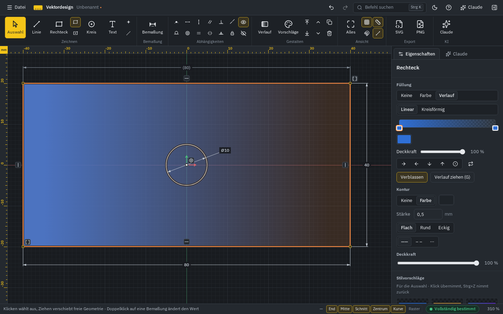
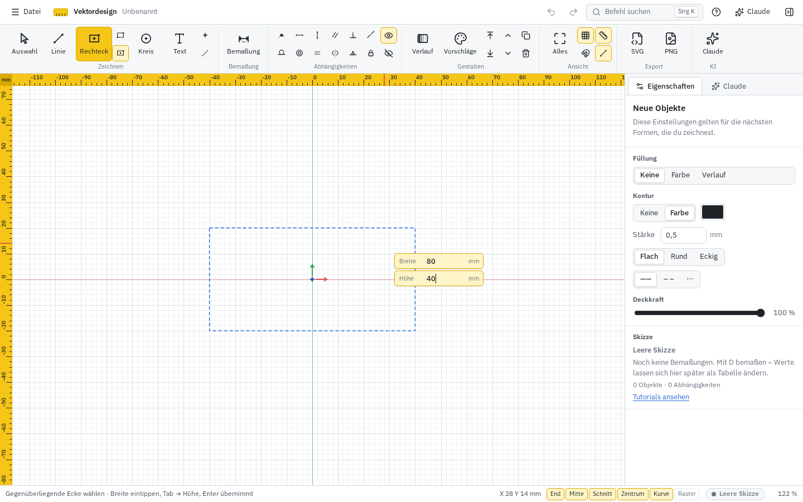
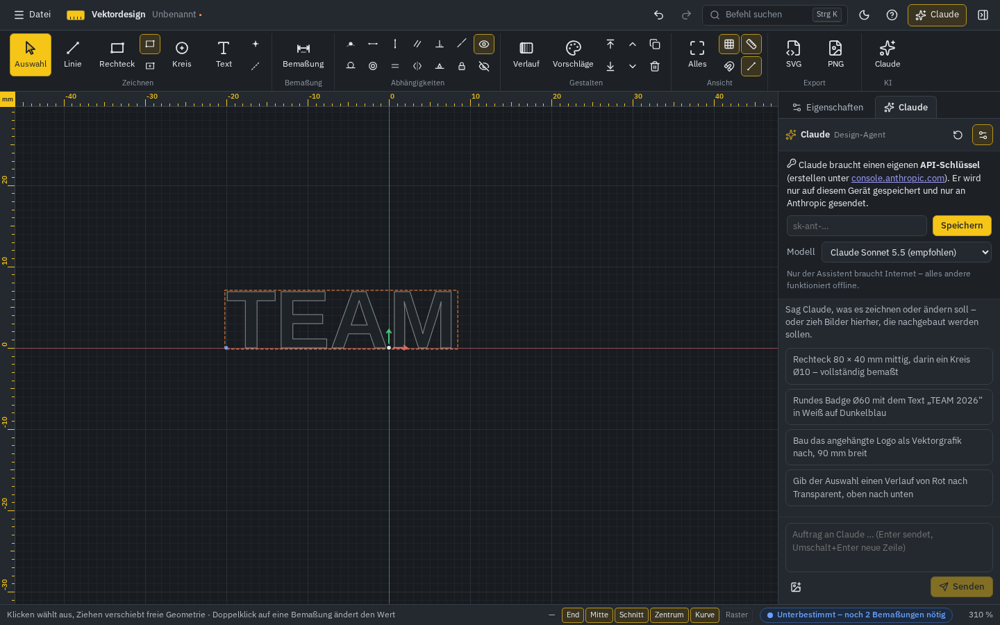

# Vektordesign

Maßgenaues 2D-Vektorgrafikprogramm für Textil-Designs. Die Bedienung folgt dem 2D-Skizzenmodus von Autodesk Inventor: **erst grob zeichnen, dann über Bemaßungen und Abhängigkeiten exakt festlegen** – die Geometrie passt sich automatisch an. Exportiert wird so, dass die Dateien direkt in der Bekleidungsproduktion (LabwearOS), auf Plottern (Cricut, Silhouette), für DTF und Siebdruck nutzbar sind.

[](https://github.com/Tojoinxx/vektordesign/actions/workflows/ci.yml)



**Stand: Meilenstein 1 (MVP Desktop)** – Linie, Rechteck, Kreis, Punkt, Text, Bemaßung mit Ausdrücken, zwölf Abhängigkeiten, Statusanzeige (unter-/voll-/überbestimmt), Füllung, Kontur und Farbverläufe, Zoom/Pan, Rückgängig, SVG- und PNG-Export, Windows-Installer über GitHub Actions. Dazu: Claude als Design-Agent in der App (auch mit Bildern), Stilvorschläge, kurze Tutorials beim ersten Benutzen eines Werkzeugs und ein dunkles Design (hell umschaltbar).

## Installation

### Windows (Desktop-App)

1. Unter [Releases](https://github.com/Tojoinxx/vektordesign/releases/latest) die Datei `Vektordesign_<Version>_x64-setup.exe` herunterladen und starten. Das Setup braucht keine Administratorrechte.
2. Das Programm ist noch nicht signiert. Zeigt Windows SmartScreen eine Warnung: „Weitere Informationen“ → „Trotzdem ausführen“.

Die App läuft komplett offline. Sie nutzt die in Windows 10/11 eingebaute WebView2-Laufzeit; fehlt sie, installiert das Setup sie nach. Für die Verteilung über die IT liegt zusätzlich ein `.msi`-Paket bei.

Jeder Push baut außerdem einen Test-Installer: im Reiter **Actions** → Lauf „CI“ → Artefakt **Vektordesign-Windows**.

### Ohne Installation

- **Einzeldatei:** `Vektordesign.html` aus dem Release herunterladen und doppelklicken. Die ganze App steckt in dieser einen Datei und läuft offline in Chrome, Edge oder Firefox.
- **Web-Version:** <https://tojoinxx.github.io/vektordesign/> im Browser öffnen.

### iPad (Web-App auf dem Home-Bildschirm)

1. In **Safari** <https://tojoinxx.github.io/vektordesign/> öffnen.
2. Teilen-Knopf → **Zum Home-Bildschirm**. Vektordesign startet dann wie eine App im Vollbild und funktioniert nach dem ersten Öffnen auch **ohne Internet**.
3. Neue Versionen lädt die App im Hintergrund; sie fragt, bevor sie neu startet. Die Zeichnung bleibt erhalten.

### Aus dem Quellcode

Voraussetzungen: [Node.js](https://nodejs.org) 22 oder neuer; für die Desktop-App zusätzlich [Rust](https://rustup.rs) und unter Windows die „Visual Studio Build Tools“ mit „Desktopentwicklung mit C++“.

```bash
npm install
npm run dev            # Web-Version unter http://localhost:5173
npm run desktop:dev    # Desktop-Fenster mit Live-Neuladen
npm run desktop:build  # Installer unter src-tauri/target/release/bundle/
```

## Bedienung

### Grundprinzip

1. **Grob zeichnen** – Linie (`L`), Rechteck (`R`), Kreis (`C`), Text (`T`). Beim Zeichnen entstehen automatisch Abhängigkeiten (z. B. horizontal, vertikal, koinzident), erkennbar an kleinen Symbolen (Glyphen).
2. **Bemaßen** – `D`, dann eine Linie, zwei Punkte, einen Kreis oder zwei Linien (Winkel) anklicken, das Maß platzieren und den Wert eintippen. Erlaubt sind Ausdrücke wie `20+5`, `d0/2`, `12,5`, `(d0-10)/2`, `max(d1; 20)` und Einheiten (`cm`, `in`, `°`). Doppelklick auf eine Bemaßung ändert sie.
3. **Abhängigkeiten setzen** – Koinzident, horizontal, vertikal, parallel, rechtwinklig, kollinear, tangential, konzentrisch, gleich, symmetrisch, Mittelpunkt, fixiert. Objekte vorher auswählen oder das Werkzeug wählen und nacheinander anklicken.
4. **Status prüfen** – unten rechts: blau *Unterbestimmt – noch X Bemaßungen nötig*, grün *Vollständig bestimmt*, rot *Überbestimmt* mit verständlicher Meldung. Ein Klick auf den Status zeigt, was noch frei ist. Würde ein Maß die Skizze überbestimmen, bietet die App an, es als getriebene Bemaßung (Referenz, in Klammern) anzulegen.

Während des Zeichnens lassen sich Länge, Winkel, Breite, Höhe oder Durchmesser direkt eintippen: einfach Zahlen tippen, `Tab` wechselt das Feld, `Enter` übernimmt.

### Abnahmetest Meilenstein 1 (in einer Minute)



1. Rechteck-Werkzeug `R`, daneben die Variante „Rechteck vom Mittelpunkt“ wählen.
2. Auf den Ursprung (Achsenkreuz) klicken, die Maus etwas zur Seite bewegen, `80` tippen, `Tab`, `40`, `Enter`.
3. Kreis `C`, auf die Rechteckmitte klicken, Maus etwas wegbewegen, `10` tippen, `Enter`. Status unten rechts: **Vollständig bestimmt**.
4. Export → **SVG**: Der Dialog zeigt 80 × 40 mm, die Datei hat `width="80mm" height="40mm"`.

Inventor-Weg: Rechteck irgendwo grob aufziehen, mit `D` die Breite (80) und Höhe (`d0/2`) bemaßen, Abhängigkeit „Koinzident“ zwischen Rechteckmitte und Ursprung, Kreis grob zeichnen, „Konzentrisch“ zur Rechteckmitte, Durchmesser mit `D` auf 10.

### Gestalten

- **Füllung und Kontur** im Bereich *Eigenschaften*: Farbwähler mit HEX, RGB, HSV und CMYK, Pipette, zuletzt benutzte Farben; Konturstärke in mm, Linienenden und Linientyp; Deckkraft pro Objekt.
- **Farbverlauf**: Füllung „Verlauf“ wählen oder mit `G` einen Strich durch die Form ziehen (`Umschalt` rastet auf 45°). Richtungen links→rechts, rechts→links, oben→unten, unten→oben und kreisförmig; „Verblassen“ lässt den Verlauf in Transparenz auslaufen.
- **Stilvorschläge**: Objekt auswählen – im Bereich *Stilvorschläge* erscheinen zehn Varianten als Vorschau, ein Klick übernimmt (`Strg+Z` nimmt zurück). Mit Claude-Schlüssel gibt es zusätzlich KI-Vorschläge zu einem Stichwort („Vintage“, „Neon“, „Vereinsfarben Blau-Weiß“).
- **Konstruktionslinien** (`Q`) sind gestrichelt und werden nie exportiert; Bemaßungen und Glyphen ebenso nicht.

### Bild als Vorlage nachzeichnen

1. **Bild** im Band (Gruppe *Zeichnen*) oder ein Foto/Logo einfach auf die Zeichenfläche ziehen bzw. mit `Strg+V` aus der Zwischenablage einfügen (PNG, JPG, WebP).
2. Das Bild landet auf einer eigenen Ebene **„Vorlage“** ganz unten, halbtransparent, und wird **nicht exportiert**.
3. Unter *Eigenschaften* die Breite in mm eintragen – oder **„Maßstab über bekannte Strecke festlegen“**: zwei Punkte im Bild anklicken (z. B. linke und rechte Kante eines Logos) und das echte Maß eingeben.
4. **Fixieren** sperrt die Ebene „Vorlage“, damit das Bild beim Nachzeichnen nicht verrutscht.
5. Mit Linie, Kreis, Freihand oder Bemaßung darüber zeichnen. Deckkraft nach Geschmack anpassen.

Soll das Bild selbst ins Motiv (z. B. für DTF), das Häkchen „Nur Vorlage“ entfernen: Dann ist es in PNG, SVG und PDF enthalten (EPS und DXF enthalten keine Pixelbilder).

### Ebenen, Bearbeiten und Messen

- **Ebenen** (Tab *Ebenen*): anlegen, umbenennen, ein-/ausblenden, sperren, Reihenfolge ändern; neue Objekte landen auf der aktiven Ebene. Ebenennamen gehen als benannte Ebenen in SVG, PDF, EPS und DXF.
- **Gruppieren** (`Strg+G`, aufheben `Strg+Umschalt+G`), **Anordnen** und **Ausrichten/Verteilen** im Bereich *Eigenschaften*.
- Registerkarte **Bearbeiten** über dem Band:
  - *Ändern*: Verschieben, Drehen, Skalieren (Faktor oder Zielbreite), Spiegeln, rechteckiges und kreisförmiges Muster – jeweils mit Eingabedialog (Ausdrücke wie `20+5` erlaubt, optional als Kopie).
  - *Skizze*: **Stutzen** (`X`) entfernt das angeklickte Linienstück bis zu den nächsten Schnittpunkten, **Dehnen** (`E`) verlängert eine Linie bis zur nächsten Geometrie.
  - *Form*: **Text in Pfade**, **Versatz** (`O`, Rand außen/innen), **Abrunden**, **Fase**, *In Form umwandeln*.
  - *Kombinieren*: **Vereinigen**, **Subtrahieren** (hinterstes minus die übrigen), **Schnittmenge**, **Ausschließen**. Text wird dabei automatisch in Pfade umgewandelt.
- **Freie Formen** (Ergebnis von Text in Pfade und booleschen Operationen) lassen sich über *Größe* (Breite oder Höhe in mm) oder mit dem Bemaßungswerkzeug `D` proportional auf ein Maß bringen; das Maß bleibt als Bemaßung erhalten.
- **Messen** (`M`): zwei Punkte → Abstand, Δx, Δy und Winkel; zwei Linien → Winkel; Klick in eine Fläche → Fläche, Umfang, Breite und Höhe. Die Zeichnung bleibt unverändert.

### Abnahmetest Meilenstein 2

1. Text `T` setzen (z. B. „TEAM“), auswählen, *Bearbeiten → Text in Pfade*.
2. Ein Rechteck als Unterstrich zeichnen, beide auswählen, *Vereinigen*.
3. Die neue Form auswählen, unter *Größe* die Breite `100` eintragen.
4. Füllung gelb setzen, einen Kreis dahinter mit Füllung blau.
5. Export SVG, PDF und PNG (300 dpi): Breite jeweils exakt 100 mm, PNG mit transparentem Hintergrund.

### Produktion und LabwearOS (Tab „Produktion“)

Die Tech-Packs entstehen in LabwearOS. Vektordesign liefert die passenden Artwork-Dateien dazu.

- **Artikel:** Name, Version und Kleidungsstück (Hoodie, T-Shirt, Sweatshirt, Cap). Daraus entstehen die Dateinamen, z. B. `Vereinshoodie_v2_Brustlogo_Schwarz.pdf`.
- **Motive:** Veredelung (Siebdruck, DTG, Puff Print, Stick, Patch, Silikondruck, Sublimation, Transferdruck, Prägung, Allover), Druckbereich (Brust links/rechts, Front A4/A3, Rücken, Nacken, Cap-Front) und Lage in mm: Oberkante unter der Kragennaht und Abstand der Motivmitte von der Mittellinie. Mehrere Motive trennst du über Ebenen.
- **Platzieren:** zeigt das Kleidungsstück in echter Größe mit Druckbereichen. Das Motiv lässt sich ziehen (rastet an Mittellinie und Druckbereichen ein) oder per Werteingabe setzen. Eine **LabwearOS-Vorlage** (PDF oder AI mit PDF-Kompatibilität) kann als Hintergrund importiert werden; danach den Bezugspunkt (Kragennaht Mitte) anklicken und über eine bekannte Strecke den Maßstab festlegen.
- **Farbvarianten:** Stofffarbe und Ersetzung jeder Motivfarbe, z. B. Gelb auf Schwarz und Rot auf Weiß.
- **Farbangaben:** HEX, CMYK (berechnet, überschreibbar) und Pantone als Freitext. Eine Pantone-Bibliothek ist lizenzpflichtig und deshalb bewusst nicht eingebaut.
- **Export-Profile:** LabwearOS, Plotter, DTF, Siebdruck – Formate, Farbmodus, PNG-Auflösung, Mindestauflösung, Spiegeln, Artwork-Blatt. Die Werte sind auf dem Gerät gespeichert; trage die Datei-Anforderungen aus deinem LabwearOS-Konto ein.
- **ZIP-Paket** mit einem Klick: alle Motive je Variante und Format (1:1, Text als Pfade, keine verknüpften Dateien), **Artwork-Blatt** (PDF, A4 quer: Platzierungsskizze vorne/hinten mit Maßen, Motiv mit Größe, Veredelung, Farbtabelle, Variantenübersicht), `Farben.csv`, `LIESMICH.txt` und optional die Projektdatei.

### Abnahmetest Meilenstein 3

1. Logo aus Meilenstein 2 öffnen, Tab **Produktion**: Artikelname und Version eintragen, Kleidungsstück „Hoodie“, Veredelung „Siebdruck“.
2. **Platzieren** → „Brust links (Trägersicht)“; bei Bedarf „Unter Kragen“ anpassen.
3. **Variante** hinzufügen, Stofffarbe und Druckfarben der zweiten Variante ändern, Pantone-Code als Freitext eintragen.
4. **ZIP-Paket exportieren**: Das Paket enthält je Variante PDF, SVG und PNG (300 dpi) sowie das Artwork-Blatt.

### iPad, Apple Pencil und Sync

| Geste | Wirkung |
| --- | --- |
| Apple Pencil | zeichnet und wählt aus (präzise, mit Fang) |
| ein Finger | zeichnet, solange kein Stift benutzt wurde; danach verschiebt er nur (Handballen werden ignoriert) |
| Tipp mit dem Finger (bei Stiftbedienung) | Markierungsmenü zum schnellen Werkzeugwechsel |
| zwei Finger auseinander/zusammen | Zoom und Verschieben |
| Zwei-Finger-Tipp / Drei-Finger-Tipp | Rückgängig / Wiederholen |
| langes Drücken | Kontextmenü |
| Doppeltipp | wie Doppelklick (z. B. Bemaßung ändern) |

- **Freihand** (`S`, auch im Markierungsmenü): grob zeichnen, beim Absetzen entsteht saubere Geometrie – Linie (fast waagrecht/senkrecht wird exakt), Kreis, Rechteck, Dreieck/Vieleck oder Linienzug. Danach wie gewohnt bemaßen.
- **Ziffernblock:** Auf Touch-Geräten erscheint beim Bemaßen ein großer Ziffernblock statt der Bildschirmtastatur (Ausdrücke wie `30+5` gehen auch).
- **Teilen-Menü:** Exporte und „Speichern“ öffnen auf dem iPad das Teilen-Menü – „In Dateien sichern“ (iCloud Drive, OneDrive), AirDrop, Mail oder direkt die Cricut-App.
- Oberfläche: größere Bedienelemente bei Touch, Werkzeugband einklappbar (Pfeil rechts neben den Registerkarten), Seitenleiste schiebt sich auf schmalen Bildschirmen über die Zeichnung.
- Der Doppeltipp auf den Apple Pencil kann von Web-Apps nicht abgefragt werden (Einschränkung von Safari); der Werkzeugwechsel geht über den Finger-Tipp und das Markierungsmenü.

**Sync zwischen PC und iPad** über einen Ordner in iCloud Drive oder OneDrive:

1. Am PC das Projekt in den Cloud-Ordner speichern (iCloud für Windows bzw. OneDrive). Desktop-App und Chrome/Edge bleiben mit der Datei verbunden – unten in der Statusleiste steht dann der Dateiname mit Wolke.
2. Auf dem iPad **Datei → Öffnen** und die Datei in *Dateien* (iCloud Drive/OneDrive) wählen, weiterzeichnen.
3. Auf dem iPad **Speichern** → Teilen-Menü → **In Dateien sichern** → denselben Ordner wählen → **Ersetzen**.
4. Der PC merkt die Änderung innerhalb weniger Sekunden und übernimmt sie („Änderungen von iPad übernommen“).

Jede Speicherung erhöht eine Revisionsnummer in der Datei und vermerkt das Gerät. Hat der PC gleichzeitig eigene ungespeicherte Änderungen, fragt er nach: Version vom iPad laden, eigene Version behalten (überschreibt beim Speichern) oder beide behalten (eigene als Kopie sichern). Safari erlaubt Web-Apps keinen dauerhaften Zugriff auf einen Ordner – deshalb öffnet und sichert das iPad über *Dateien*.

### Darstellung

Standard ist das dunkle Design. Über das Mond-Symbol oben rechts lassen sich das **Design** (Dunkel, Hell, Wie System) und unabhängig davon die **Zeichenfläche** (Passend, Hell, Dunkel) umschalten; die Wahl bleibt auf dem Gerät gespeichert. Eine helle Zeichenfläche im dunklen Design zeigt dunkle Motive so, wie sie auf hellem Stoff wirken. Motive, die sich kaum vom Hintergrund abheben (schwarz auf dunkler Fläche, weiß auf weißer), bekommen am Bildschirm einen feinen Umriss. Exportiert wird immer ohne Hintergrund und in den echten Farben.

### Claude in der App



Im Tab **Claude** (`Strg+I`) beschreibst du, was entstehen soll – Claude zeichnet, bemaßt, setzt Abhängigkeiten und Farben direkt in der Zeichnung und prüft das Ergebnis anhand einer Vorschau. Bilder (Logo, Skizze, Foto) lassen sich per Schaltfläche, Drag & Drop oder `Strg+V` anhängen, z. B. zwei Bilder mit dem Auftrag „das erste in den Vordergrund, das zweite als Hintergrund mit Verblassen“. Alle Änderungen eines Auftrags sind ein einziger Schritt – `Strg+Z` macht alles rückgängig.

**Ohne API-Schlüssel (mit deinem Claude-Abo):** Im Claude-Tab „Mit Claude-Abo“ wählen, Wunsch eintippen und **Auftrag kopieren**. Den Text in [claude.ai](https://claude.ai) einfügen (Bilder dort anhängen) und senden. Claudes Antwort komplett kopieren, im Claude-Tab bei „Antwort von Claude“ einfügen und **Ausführen** – die App zeichnet alles in einem Rückgängig-Schritt, mit Bemaßungen und Abhängigkeiten.

**Mit API-Schlüssel:** Einrichtung: Unter [console.anthropic.com](https://console.anthropic.com) einen API-Schlüssel erstellen und im Claude-Tab einfügen. Der Schlüssel wird nur auf diesem Gerät gespeichert und nur an die Anthropic-API gesendet; die Kosten pro Auftrag rechnet Anthropic nach Verbrauch ab. Nur der Assistent braucht Internet.

### Export

| Format | Eigenschaften |
| --- | --- |
| SVG | Maße in mm (`width`/`height` in mm, `viewBox` in mm), benannte Ebenen, Text wahlweise als Pfade (Standard), ohne Bemaßungen, Glyphen und Konstruktionslinien – passt für Illustrator, Inkscape, Cricut Design Space und Silhouette Studio |
| PDF | Vektor-PDF in Originalgröße (Seite = Motiv), Ebenen als PDF-Ebenen (in Illustrator/Acrobat sichtbar), Verläufe und Verblassen, Deckkraft, RGB oder CMYK, Text als Pfade |
| EPS | PostScript Level 3 für ältere Programme, RGB oder CMYK, Verläufe; ohne Transparenz (wird beim Export angezeigt) |
| DXF | R12, Einheit mm, Ebenen als Layer, Kreise als echte Kreise, Kurven fein angenähert – für Plotter und Schnittmuster-Software; ohne Farben |
| PNG | 300, 360, 600, 720 oder 1200 dpi, transparenter Hintergrund, Auflösung im Dateikopf (pHYs) |
| Projekt (`.vdp`) | Geometrie, Bemaßungen, Abhängigkeiten und Stile; wird zusätzlich automatisch zwischengespeichert |

Optional beim Export: Rand inklusive Konturstärke und horizontal spiegeln (Flexfolie).

## Tastenkürzel

| Taste | Befehl | | Taste | Befehl |
| --- | --- | --- | --- | --- |
| `L` | Linie (Kettenmodus) | | `Strg+Z` / `Strg+Y` | Rückgängig / Wiederholen |
| `R` | Rechteck | | `Strg+C` / `Strg+V` | Kopieren / Einfügen |
| `C` | Kreis | | `Strg+D` | Duplizieren |
| `T` | Text | | `Entf` | Löschen |
| `P` | Punkt | | `Strg+A` | Alles auswählen |
| `D` | Bemaßung | | `Strg+N` / `Strg+O` | Neu / Öffnen |
| `G` | Farbverlauf ziehen | | `Strg+S` / `Strg+Umschalt+S` | Speichern / Speichern unter |
| `Q` | Konstruktionsgeometrie ein/aus | | `Strg+E` | Exportieren |
| `F` | Alles anzeigen | | `Strg+K` | Befehlssuche |
| `+` / `−` | Vergrößern / Verkleinern | | `Strg+I` | Claude-Assistent |
| `F8` / `F9` | Abhängigkeiten ein-/ausblenden | | `Strg+]` / `Strg+[` | Nach vorne / nach hinten |
| `X` | Stutzen | | `Strg+Umschalt+]` / `[` | Ganz nach vorne / hinten |
| `E` | Dehnen | | `Strg+G` | Gruppieren |
| `O` | Versatz | | `Strg+Umschalt+G` | Gruppierung aufheben |
| `M` | Messen | | | |
| `S` | Freihandskizze mit Formerkennung | | | |
| `Esc` | Abbrechen, zurück zur Auswahl | | | |

Maus: Mausrad zoomt zur Mausposition, mittlere Maustaste oder `Leertaste` + Ziehen verschiebt die Ansicht, Rechtsklick öffnet das Markierungsmenü (wie in Inventor; Rechtsklick gedrückt halten und in eine Richtung ziehen startet den Befehl direkt). Fang an Endpunkt, Mitte, Schnittpunkt, Kreismittelpunkt, Kurve und Raster lässt sich unten in der Statusleiste umschalten.

## Entwicklung

| Befehl | Zweck |
| --- | --- |
| `npm run dev` | Entwicklungsserver (Browser) |
| `npm run build` | Typprüfung und Produktionsbuild nach `dist/` |
| `npm run build:single` | Ganze App als eine HTML-Datei: `dist-single/Vektordesign.html` |
| `npm test` | Unit-Tests: Ausdrücke, Solver, Abnahme M1, Export, Claude-Werkzeuge |
| `npm run test:e2e` | Bedienung im echten Browser inkl. Abnahme M1–M4 (iPad-Emulation mit Touch und Stift, offline, Sync) (`CHROME_PATH` setzen) |
| `npm run test:desktop` | Startet die Desktop-App und prüft Solver, Export und Dateibefehle im echten Fenster |
| `npm run desktop:build` | Windows-Installer (NSIS-Setup und MSI) |
| `npm run version:set -- 0.2.0` | Versionsnummer überall gleich setzen |

### Aufbau

Datenmodell, Solver und Darstellung sind strikt getrennt. Werkzeuge, Oberfläche und der Claude-Assistent ändern die Zeichnung ausschließlich über dieselben Editor-Befehle – dadurch ist alles rückgängig zu machen und testbar.

```
src/
  model/      Datenmodell in mm (Punkte, Linien, Kreise, Text, Pfade, Formen), Ebenen, Farben, Verläufe,
              boolesche Operationen, Produktion (Motive, Varianten), Kleidungsstücke, Export-Profile
  params/     Ausdrücke und Parameter der Bemaßungen (d0, d1 …)
  solver/     planegcs (FreeCAD-Solver als WebAssembly): Zerlegung in Teilsysteme, Freiheitsgrade, Konflikte
  store/      Zustand und Editor-Befehle mit Rückgängig/Wiederholen
  render/     Canvas-Darstellung: Raster, Maßband-Lineale, Bemaßungen, Glyphen
  tools/      Werkzeuge: Auswahl, Zeichnen, Bemaßung, Abhängigkeiten, Verlauf, Stutzen/Dehnen, Messen, Fang
  export/     SVG, PDF, EPS, DXF, PNG, Artwork-Blatt und ZIP-Paket
  assistant/  Claude-Anbindung (Messages-API mit Werkzeugen und Bildern)
  design/     Stilvorschläge
  platform/   Dateien, Schriftarten und -umrisse, PDF-Vorlagen-Import, Zwischenspeicher
  ui/         React-Oberfläche
src-tauri/    Desktop-Hülle (Tauri 2, Rust): Dateizugriff und Schriftarten
tests/        Unit-, Browser- und Desktop-Tests
```

**Warum Tauri statt Electron?** Der Installer ist nur wenige MB groß statt rund 100 MB, die App braucht deutlich weniger Arbeitsspeicher, weil sie die in Windows eingebaute WebView2 nutzt statt einen eigenen Chromium mitzubringen, und Tauri erzeugt NSIS- und MSI-Installer direkt. Dieselbe Oberfläche läuft unverändert als Web-Version für das iPad.

### Release veröffentlichen

Auf github.com unter **Actions → Release → Run workflow** die Version eingeben (z. B. `0.2.0`), das geht auch vom Handy. Alternativ per Git:

```bash
git tag v0.2.0
git push origin v0.2.0
```

Der Workflow „Release“ übernimmt die Version, testet, baut den Installer und hängt `.exe`, `.msi` und die Einzeldatei `Vektordesign.html` an ein GitHub-Release. Versionsnummern bestehen nur aus Zahlen (`v1.2.3`), weil der MSI-Installer nichts anderes erlaubt.

### GitHub einrichten (einmalig)

- **Settings → Pages → Build and deployment → Source: „GitHub Actions“**, damit der Workflow „Web-Version“ die App veröffentlichen kann.
- Die Workflows nutzen nur das automatische `GITHUB_TOKEN`; weitere Geheimnisse sind nicht nötig.

## Fahrplan

1. ✅ MVP Desktop
2. ✅ Gestaltung und Bearbeiten: Ebenen, Gruppen, Ausrichten, boolesche Operationen, Stutzen/Dehnen/Abrunden/Versatz, Muster, Messen, Text in Pfade, PDF/EPS/DXF
3. ✅ LabwearOS-Export: Vorlagen-Import, Platzierung auf dem Kleidungsstück, Artwork-Blatt, Export-Profile, ZIP-Paket
4. ✅ iPad: installierbare Web-App, Touch- und Apple-Pencil-Bedienung, Formerkennung, Sync über iCloud Drive/OneDrive
5. Textil- und Komfortfunktionen: Mockups, Farbseparation, Plotter-Prüfung, Rapport, Größenstaffel, Kostenschätzung

## Lizenz

MIT – siehe [LICENSE](LICENSE). Verwendete Bibliotheken und ihre Lizenzen: [THIRD_PARTY_NOTICES.md](THIRD_PARTY_NOTICES.md). Pantone-Codes werden nur als Freitext erfasst; eine Pantone-Bibliothek ist lizenzpflichtig und wird bewusst nicht eingebaut.
